<a href="https://patelkrushang.com">
  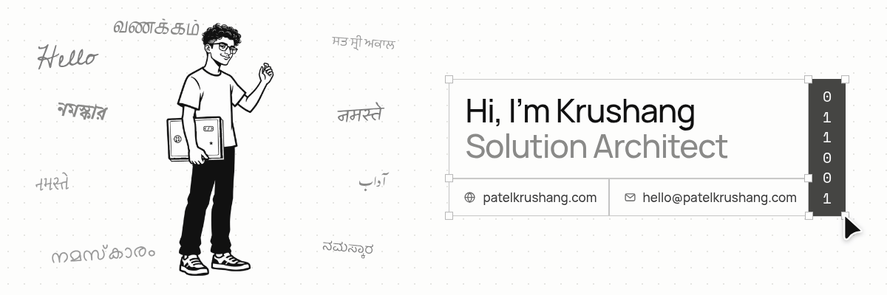
</a>

I live in Ahmedabad and work as a Solution Architect at [Satat Technologies](https://erpnext.satat.tech/), where I lead the design of a complete digital lending system on [Frappe](https://frappe.io).

I joined Satat as a Flutter intern in December 2024, moved to Frappe when the company did, and became Solution Architect 19 months later. Along the way I've implemented ERP, led projects, supported sales and built internal products.

- 🔭 **Now:** a loan origination and management system (LOS / LMS) for an NBFC, a non-banking lender, in active development
- 🤖 **Next:** an AI project to automate Frappe implementation, under development as [NextIQ](https://nextiq.in/)
- 🏆 **Before:** five hackathon and app competition wins during my B.Tech in IT at Parul University
- 🚀 **Building a startup.** Say hello if you invest or build.
- 📫 [hello@patelkrushang.com](mailto:hello@patelkrushang.com) · [LinkedIn](https://www.linkedin.com/in/0krushang/) · [Instagram](https://www.instagram.com/0krushang) · [patelkrushang.com](https://patelkrushang.com)

Company and client code is private, so each card below links to the full story on my site, with live demos.

## At Satat Technologies

<table>
  <tr>
    <th width="33%">Calling Agent</th>
    <th width="33%">NextIQ</th>
    <th width="33%">Interactive SOW</th>
  </tr>
  <tr>
    <td><a href="https://patelkrushang.com/interesting-customer-story">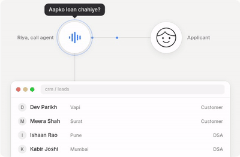</a></td>
    <td><a href="https://patelkrushang.com/nextiq">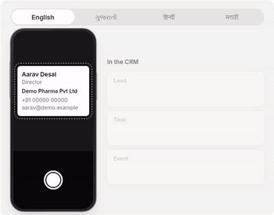</a></td>
    <td><a href="https://patelkrushang.com/interactive-sow">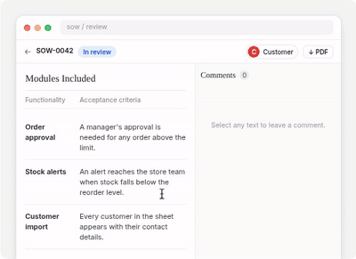</a></td>
  </tr>
  <tr>
    <td valign="top">A test at a customer's office became an AI calling agent, and then their whole lending platform. <a href="https://patelkrushang.com/interesting-customer-story">Read the story</a> · 2026</td>
    <td valign="top">Scans a business card, pulls out the details with AI and syncs the lead into ERPNext. <a href="https://patelkrushang.com/nextiq">Read the story</a> · <a href="https://nextiq.in/">Live</a> · 2026</td>
    <td valign="top">A statement of work as one review page, with comments on the exact words and approvals built in. <a href="https://patelkrushang.com/interactive-sow">Read the story</a> · 2026</td>
  </tr>
</table>

## More projects

<table>
  <tr>
    <th width="33%">Radheshyam Rollers</th>
    <th width="33%">Leena Fan</th>
    <th width="33%">K2Neet</th>
  </tr>
  <tr>
    <td><a href="https://patelkrushang.com/radheshyam-rollers">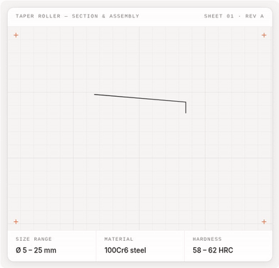</a></td>
    <td><a href="https://patelkrushang.com/leena-fans">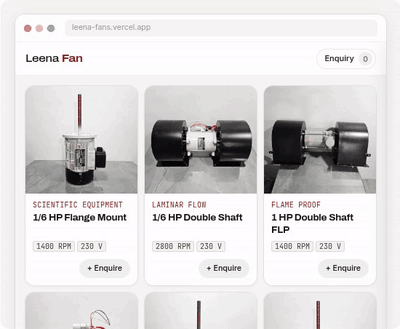</a></td>
    <td><a href="https://patelkrushang.com/k2neet">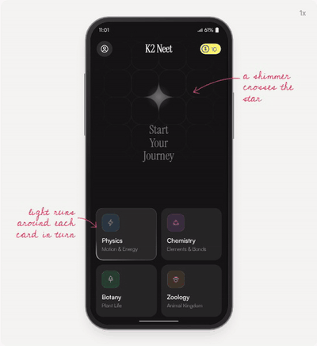</a></td>
  </tr>
  <tr>
    <td valign="top">A website for a taper roller factory in Rajkot, drawn like an engineering sheet. <a href="https://patelkrushang.com/radheshyam-rollers">Read the story</a> · <a href="https://www.radheshyamrollers.com/">Live</a> · 2026</td>
    <td valign="top">Plain electric motors turned into a website people want to stay on, with all 93 models and one enquiry list. <a href="https://patelkrushang.com/leena-fans">Read the story</a> · <a href="https://leena-fans.vercel.app/">Live</a> · 2025</td>
    <td valign="top">The Flutter frontend of an AI study app for NEET students. <a href="https://patelkrushang.com/k2neet">Read the story</a> · <a href="https://play.google.com/store/apps/details?id=com.devkaran.ai">Play Store</a> · 2025</td>
  </tr>
  <tr>
    <th>Krushak</th>
    <th>IID Website</th>
    <th>Everything else</th>
  </tr>
  <tr>
    <td><a href="https://patelkrushang.com/krushak">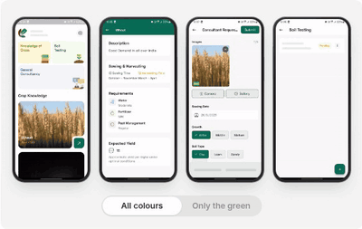</a></td>
    <td><a href="https://patelkrushang.com/iid-website">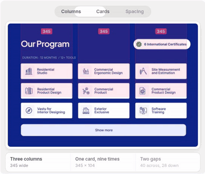</a></td>
    <td><a href="https://patelkrushang.com">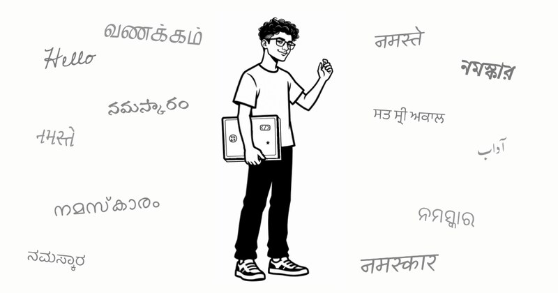</a></td>
  </tr>
  <tr>
    <td valign="top">A simple Flutter app that carries a farmer's question to someone who can answer it. <a href="https://patelkrushang.com/krushak">Read the story</a> · 2025</td>
    <td valign="top">A very long home page for an interior design institute, designed in Figma. <a href="https://patelkrushang.com/iid-website">Read the story</a> · 2024</td>
    <td valign="top">Every project, event and post, with the full story behind each one. <a href="https://patelkrushang.com">patelkrushang.com</a></td>
  </tr>
</table>

## Hackathons and events

<table>
  <tr>
    <th width="33%">Your Health Mate</th>
    <th width="33%">PU Code Hackathon</th>
    <th width="33%">Vadodara Hackathon 4.0</th>
  </tr>
  <tr>
    <td><a href="https://patelkrushang.com/your-health-mate">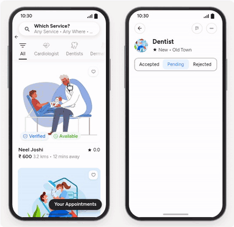</a></td>
    <td><a href="https://patelkrushang.com/pu-code-hackathon">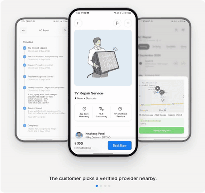</a></td>
    <td><a href="https://patelkrushang.com/vadodara-hackathon">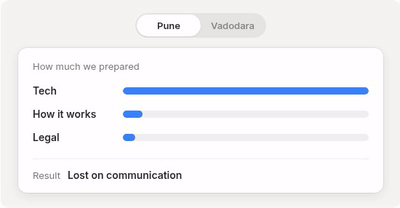</a></td>
  </tr>
  <tr>
    <td valign="top">First rank at the myOnsite Healthcare hackathon, with a Flutter health app built on Gemini AI. <a href="https://patelkrushang.com/your-health-mate">Read the story</a> · 2024</td>
    <td valign="top">First prize out of 166 teams at a 36-hour hackathon, with a home services app. <a href="https://patelkrushang.com/pu-code-hackathon">Read the story</a> · <a href="https://github.com/theexpensiveinformatics/pucodehackthon_2.O">Code</a> · 2024</td>
    <td valign="top">After losing in Pune, we prepared the product and its legal side, not only the tech, and won with Guruzone. <a href="https://patelkrushang.com/vadodara-hackathon">Read the story</a> · <a href="https://github.com/theexpensiveinformatics/guruzone">Code</a> · 2023</td>
  </tr>
  <tr>
    <th>Solving for India</th>
    <th>Brainiac Tunes</th>
    <th>Live with RJ Goldie</th>
  </tr>
  <tr>
    <td><a href="https://patelkrushang.com/solving-for-india">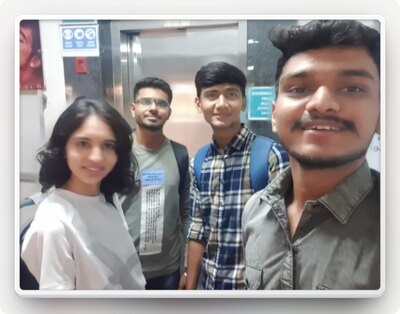</a></td>
    <td><a href="https://patelkrushang.com/brainiac-tunes">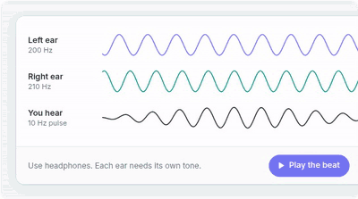</a></td>
    <td><a href="https://patelkrushang.com/rj-goldie">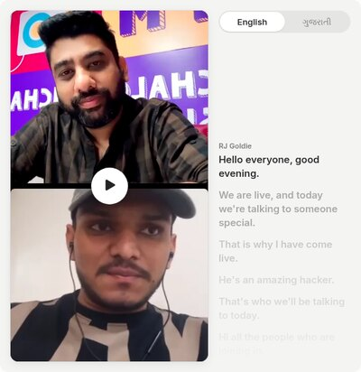</a></td>
  </tr>
  <tr>
    <td valign="top">My first real hackathon: first in the university with ResQme, an SOS and health guidance app. <a href="https://patelkrushang.com/solving-for-india">Read the story</a> · <a href="https://github.com/theexpensiveinformatics/gfgHackthon">Code</a> · 2023</td>
    <td valign="top">My first working app, a binaural beats app that won first rank and reached the Play Store. <a href="https://patelkrushang.com/brainiac-tunes">Read the story</a> · 2022</td>
    <td valign="top">A live session after the PU Code Hackathon, with a transcript in English and Gujarati. <a href="https://patelkrushang.com/rj-goldie">Watch it</a> · 2024</td>
  </tr>
</table>

## Writing

- [Tech vs ERP](https://patelkrushang.com/tech-vs-erp): how moving from pure tech to ERP changed the first question I ask.
- [An Interesting Customer Story](https://patelkrushang.com/interesting-customer-story): how a test at a customer's office became an AI calling agent, and then their whole lending platform.

## Tools

Frappe and ERPNext, Python, Flutter and Dart, Figma, Next.js, and AI agents.

Every project above has its full story, with live demos, at <a href="https://patelkrushang.com">patelkrushang.com</a>.

